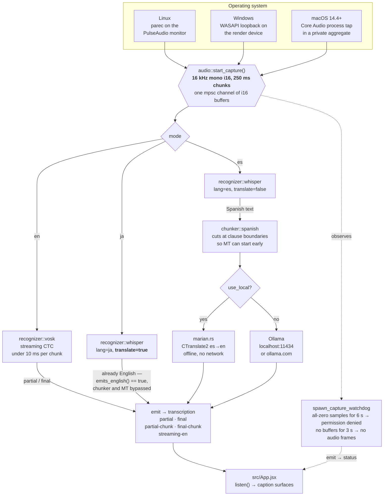
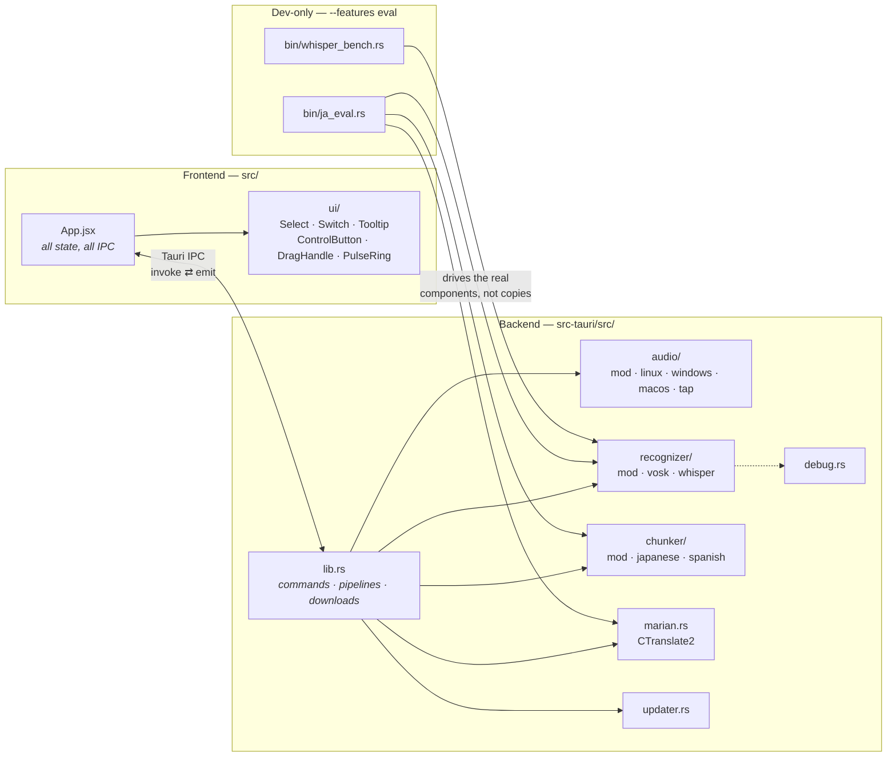
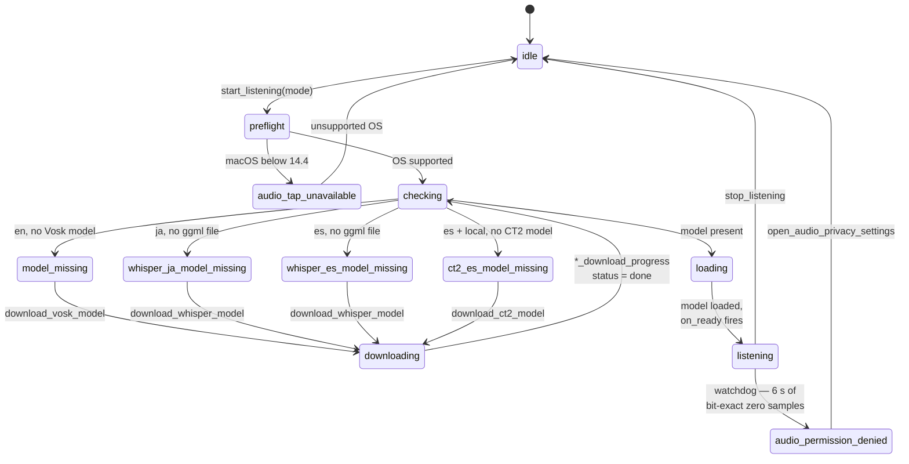
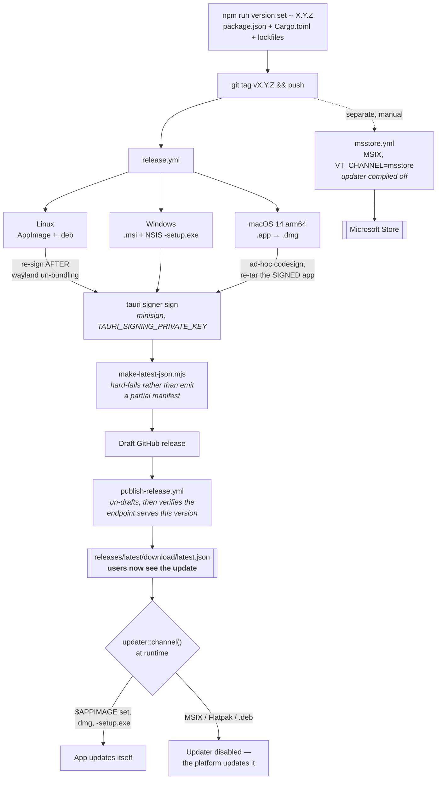

# vid_translate 🎙️

A transparent, always-on-top, frameless **live caption & translation overlay** for your
desktop — built with **Tauri v2 + React**.

It listens to your **system audio** (whatever is playing — YouTube, a meeting, a film) and
shows live captions at the bottom of your screen:

- **EN** — live English captions, streaming, fully offline
- **JA** — Japanese speech → English, translated directly from the audio
- **ES** — Spanish speech → English, with the Spanish kept on screen too

The overlay is draggable, remembers its position and size, spans the full display width by
default, and stays out of your way.

> ### 👀 Looking for the polished one? Try [Mimi](https://github.com/yuxino/Mimi).
>
> This project's entire interface is borrowed from **[Mimi](https://github.com/yuxino/Mimi)**
> by [yuxino](https://github.com/yuxino) — a far more complete, more polished and more
> capable live speech-translation app, for desktop *and* Android, with many more providers,
> languages and settings than this one has. If you want the real thing rather than my take
> on part of it, go there first. The UI you see here is theirs, under the MIT license;
> see [Credits](#-credits).

---

## ✨ Features

- 🪟 Frameless, transparent, always-on-top overlay
- ⚡ Streaming English captions — partial words appear as they are spoken
- 🇯🇵 Japanese → English translated straight from the audio by Whisper, skipping the
  lossy hop through Japanese text
- 🇪🇸 Spanish → English with a dedicated `es→en` model, Spanish caption line kept
- 🌐 Translation via **Ollama** (local or ollama.com), or fully **offline** with bundled
  CTranslate2 models — no network at all
- 📥 One-click model downloads with progress; nothing to install by hand
- 🔴 **LIVE** toggle — show only the line being spoken, hide the history
- 🖱️ Drag anywhere, resize freely — size and position persist across launches
- 🎨 Settings console: translation, speech, appearance and layout
- 🖥️ Linux (PulseAudio/PipeWire), Windows (WASAPI loopback), macOS (Core Audio process
  tap — driverless)
- 🎮 Whisper runs on the GPU everywhere: Metal on macOS, **Vulkan** on Windows and Linux —
  integrated GPUs included (Intel Iris Xe, AMD Radeon iGPUs). No usable GPU → it falls back
  to the CPU on its own. Set `VID_TRANSLATE_NO_GPU=1` to force the CPU

---

## 📁 Project Structure

```
vid_translate/
├── index.html                      # Single HTML page Tauri loads (mounts #root)
├── package.json                    # Frontend deps (React 19, Vite 7, lucide-react) & scripts
├── vite.config.js                  # Vite dev-server config for Tauri (port 1420)
├── README.md                       # This file
├── THIRD_PARTY_NOTICES.md          # License notices for borrowed code (Mimi, Lucide)
├── ja-chunking-plan.md             # Historical: the JA chunking plan and why it was wrong
│
├── docs/                           # ── Design notes & measurements ──
│   ├── ja-diagnosis.md             # JA→EN quality teardown; the BLEU numbers come from here
│   ├── bench-whisper.md            # How to measure what a Whisper pass costs
│   └── perf-handoff.md             # Why GPU/Vulkan became the default
│
├── eval/                           # Offline translation-quality harness (BLEU/chrF)
│   ├── run.sh                      # Builds ja_eval and scores the corpus
│   └── ja/, es/                    # Clips + hand-written English references
│
├── scripts/
│   ├── tauri.mjs                   # `npm run tauri` — applies the Windows path-length fix
│   ├── dev-macos.sh                # macOS dev: builds + signs so TCC can grant audio access
│   ├── fetch-libvosk-macos.sh      # Downloads the universal2 libvosk.dylib
│   ├── bump-version.mjs            # `npm run version:set` — package.json + Cargo + lockfiles
│   ├── make-latest-json.mjs        # Assembles the updater manifest (hard-fails if partial)
│   └── bench-whisper.sh / .ps1     # Drives the whisper_bench matrix
│
├── packaging/msix/                 # Microsoft Store packaging (manifest + pack script)
├── .github/workflows/              # release, publish-release, msstore, msstore-diagnose
├── assets/, public/                # Logo (SVG)
│
├── src/                            # ── React frontend ──
│   ├── main.jsx                    # React entry point
│   ├── App.jsx                     # All app state, IPC wiring, and the three surfaces
│   ├── App.css                     # Base layer: tokens, motion, scrollbars
│   ├── overlay.css                 # Caption surfaces: canvas, timeline, setup cards
│   ├── settings.css                # Settings console: sidebar, cards, rows, controls
│   └── ui/                         # Shared controls, ported from Mimi (see Credits)
│       ├── Icon.jsx                # Lucide wrapper, icons at 1em in the current colour
│       ├── PulseRing.jsx/.css      # The "sound light" session-phase indicator
│       ├── ControlButton.jsx/.css  # 24px overlay control, icon or short word
│       ├── DragHandle.jsx          # The always-visible move affordance
│       ├── Select.jsx/.css         # Portalled picker with full keyboard support
│       ├── Switch.jsx              # Settings toggle
│       └── Tooltip.jsx/.css        # Shared label for compact controls
│       └── tooltipPosition.js      # Flip/clamp logic that keeps tooltips on screen
│
└── src-tauri/                      # ── Rust backend ──
    ├── Cargo.toml                  # Deps; `eval` feature gates the two dev binaries
    ├── build.rs                    # rpaths for libvosk, re-exports VT_CHANNEL
    ├── tauri.conf.json             # Window config, updater pubkey (+ 3 platform overlays)
    ├── Info.plist                  # macOS: TCC usage strings + bundle id for the dev binary
    ├── entitlements.plist          # macOS: for whenever real Developer ID signing happens
    ├── capabilities/default.json   # Tauri permissions
    ├── vendor/, *.dll              # Prebuilt libvosk per platform
    └── src/
        ├── main.rs                 # Binary entry point; calls lib.rs
        ├── lib.rs                  # Commands, the three pipelines, downloads, status events
        ├── audio/                  # System-audio capture per platform
        │   ├── mod.rs              # Shared capture API, preflight, mic fallback
        │   ├── linux.rs            # PulseAudio/PipeWire via `parec`
        │   ├── windows.rs          # WASAPI loopback
        │   ├── macos.rs            # Core Audio tap drain + downmix/resample to 16k
        │   └── tap.rs              # The process-tap unsafe layer (macOS 14.4+)
        ├── recognizer/             # Speech recognition backends behind one enum
        │   ├── mod.rs              # `Backend` + `run()`; `emits_english()` decides the path
        │   ├── vosk.rs             # Streaming CTC (English)
        │   └── whisper.rs          # whisper.cpp (Japanese, Spanish)
        ├── chunker/                # Clause-boundary detection, so translation starts early
        │   ├── mod.rs              # `for_language()`; the shared boundary contract
        │   ├── japanese.rs         # Only used in JA two-stage mode
        │   └── spanish.rs
        ├── marian.rs               # Offline translation via CTranslate2 (`ct2rs`)
        ├── updater.rs              # app_info / check_for_update / install_update
        ├── debug.rs                # Diagnostic logging (VID_TRANSLATE_DEBUG_ASR)
        └── bin/                    # Dev-only, behind `--features eval`
            ├── ja_eval.rs          # Offline eval runner — drives the real pipeline
            └── whisper_bench.rs    # Measures one Whisper config, prints a CSV row
```

---

## 🏗️ System Design

### 1. Runtime: audio → caption

One capture contract feeds three different pipelines. The mode decides the recognizer, and
the recognizer decides whether a translation stage exists at all.



> **Why JA skips the chunker.** Whisper's translate task returns English, so there is nothing
> left to chunk and nothing left to translate — `native_en` short-circuits both stages and the
> text goes straight to the screen. `VID_TRANSLATE_JA_TWO_STAGE=1` restores the chunker and MT
> path for hand comparison. See [Why this split](#-why-this-split).

### 2. Module map

Who owns what, and who calls whom.



`lib.rs` is the only module that knows which mode is running. `audio/` does not know what
recognizes its chunks; `recognizer/` does not know what happens to its text. That is what let
Japanese move from Vosk to Whisper without touching the pipeline, and what the eval binaries
exploit to measure the shipped code rather than a reimplementation of it.

### 3. Model acquisition & setup state

No model ships inside the app. Every pipeline checks its model on start and emits a status
the frontend turns into a one-click download card.



Everything lands under one directory:

```
~/.local/share/vid_translate/                   (Linux)
%LOCALAPPDATA%\vid_translate\                   (Windows)
~/Library/Application Support/vid_translate/    (macOS)
    ├── vosk-model              # English recognition (Vosk is English-only)
    ├── ggml-small.bin          # Whisper, for JA and ES — size is your choice
    ├── ct2-model-ja            # Offline ja→en (only for two-stage mode)
    └── ct2-model-es            # Offline es→en
```

### 4. Build & release

A tag is the build trigger; publishing the draft is the rollout switch.



> `latest.json` is all-or-nothing: Tauri validates the whole manifest before comparing
> versions, so one missing signature breaks updates on *every* platform, not just the one.
> That is why the generator fails the build instead of degrading.

---

## 🌐 How the EN / JA / ES modes work

The **mode button** in the overlay cycles the three modes while stopped
(`EN → JA → ES → EN …`). Each is a different pipeline, and they do not share a recognizer:
English streams with Vosk, Japanese and Spanish both recognise with Whisper, for reasons
measured rather than assumed (see [Why this split](#-why-this-split)).

<details>
<summary><b>🇬🇧 EN — Live English captions</b></summary>

<br>

1. System audio is captured at 16 kHz mono (PulseAudio on Linux, WASAPI loopback on
   Windows, a Core Audio process tap on macOS).
2. 250 ms chunks stream into the **Vosk English model** (`vosk-model-small-en-us-0.15`).
3. Vosk emits **partial** results (the sentence being spoken right now, updating live) and
   **final** results (completed utterances).
4. Captions appear as a single-line ticker — no translation step, no network, fully offline.

**Latency:** ~100–200 ms end-to-end — the "YouTube captions" feel.

</details>

<details>
<summary><b>🇯🇵 JA — Japanese speech → English</b></summary>

<br>

Japanese is translated **straight from the audio** by Whisper's own translate task. There is
no Japanese-text middle step, because that handoff is where the meaning was being lost:

| Path | BLEU | chrF |
|---|---|---|
| Whisper transcribe → `ja→en` model | *baseline* | *baseline* |
| **Whisper translate (direct)** | **+6.67** | **+4.76** |

Measured on a 36-minute multi-speaker clip. The direct path also deletes a stage and a
240 MB model.

1. Audio streams into **whisper.cpp** with the translate task.
2. A **chunker** (`src-tauri/src/chunker/japanese.rs`) watches for clause boundaries so a
   line can be committed before the speaker finishes the sentence.
3. The in-progress clause is shown as a dimmed, italic **live line** that re-translates and
   corrects itself as the Japanese predicate lands; committed clauses settle into the
   history above it.

Set `VID_TRANSLATE_JA_TWO_STAGE=1` to restore the old transcribe-then-translate path for
hand comparison.

</details>

<details>
<summary><b>🇪🇸 ES — Spanish speech → English</b></summary>

<br>

Spanish takes the **opposite** decision to Japanese, for the same reason — evidence:

| Path | BLEU | chrF |
|---|---|---|
| Vosk → `es→en` model | 30.68 | 62.88 |
| Whisper translate (direct) | 33.56 | 65.15 |
| **Whisper transcribe → `es→en` model** | **39.60** | **67.24** |

Measured on a 9.6-minute Spanish clip against human subtitles. Spanish and English are
close and `es→en` is a strong high-resource model, so nothing is lost handing it text —
whereas Japanese loses meaning in that same handoff.

Keeping the translation stage also keeps the **Spanish caption line**: one Whisper pass
yields either the source text or English, never both, and this mode shows source beneath
translation.

</details>

<details>
<summary><b>🌐 Translation: Ollama or fully offline</b></summary>

<br>

Wherever a translation stage exists (ES always; JA only in two-stage mode), it runs one of
two ways, switched by **LOCAL** in the overlay or **Translate locally** in Settings:

- **Ollama** — leave the API key empty to use `http://localhost:11434`, or set an
  [ollama.com](https://ollama.com) key for hosted models. Settings can **pull** a model with
  a progress bar.
- **Local / offline** — a quantized **CTranslate2** Marian model (`ct2rs`), downloaded on
  demand. No network, no Ollama, no API key.

</details>

<details>
<summary><b>📥 Models — all downloaded on demand</b></summary>

<br>

The first time you start a mode whose model is missing, the overlay shows a **Download**
card with progress. Everything lands under one directory:

```
~/.local/share/vid_translate/                   (Linux)
%LOCALAPPDATA%\vid_translate\                   (Windows)
~/Library/Application Support/vid_translate/    (macOS)
    ├── vosk-model              # English recognition
    ├── ggml-small.bin          # Whisper, for JA and ES — size is your choice
    ├── ct2-model-ja            # Offline ja→en (only for two-stage mode)
    └── ct2-model-es            # Offline es→en
```

Whisper sizes run from **Tiny (31 MB)** to **Medium (1.4 GB)**; `small` is the default and
what the numbers above were measured at. If captions fall further and further behind the
audio, that machine cannot keep up with the current size — drop one. The `q5` entries are
the same models quantized: about a third of the size and noticeably faster, for a small
accuracy loss.

</details>

---

## 🚀 Install & Run Locally (development)

### Prerequisites

| Requirement | Notes |
|---|---|
| **Node.js** ≥ 18 + npm | Frontend tooling |
| **Rust** (stable) + Cargo | Install via [rustup](https://rustup.rs) |
| **Tauri v2 system deps** | Linux: `webkit2gtk-4.1`, `libappindicator`, etc. — see [Tauri prerequisites](https://v2.tauri.app/start/prerequisites/). macOS: Xcode Command Line Tools + CMake (`brew install cmake`) |
| **Vulkan SDK (Linux / Windows)** | Whisper's GPU backend. Windows: `winget install KhronosGroup.VulkanSDK`, then open a new terminal. Fedora: `sudo dnf install vulkan-headers vulkan-loader-devel glslc`. Ubuntu/Debian: `sudo apt install libvulkan-dev glslc`. Build-time only — users of the installed app need nothing beyond their normal GPU driver |
| **C++ toolchain + CMake (Windows)** | Visual Studio Build Tools with *Desktop development with C++*, and CMake (`winget install Kitware.CMake`) — whisper.cpp and CTranslate2 are compiled from source |
| **libvosk (macOS only)** | `bash scripts/fetch-libvosk-macos.sh` once before the first build |
| **Ollama** *(optional)* | Only for Ollama-backed translation; the offline CTranslate2 path needs nothing — [ollama.com/download](https://ollama.com/download) |

### Steps

```bash
git clone <repo-url>
cd vid_translate
npm install
npm run tauri dev          # Linux / Windows
npm run dev:macos          # macOS — see below
```

**On macOS use `npm run dev:macos`.** Plain `tauri dev` runs a bare binary rather than an
`.app`, which macOS cannot grant audio-recording permission to — system audio capture then
silently produces nothing at all. The script builds, signs the binary with the real bundle
identifier, and then starts the dev server. macOS asks for permission again after each
rebuild, because ad-hoc signatures change every time.

- First compile takes **5–15 minutes** (builds the Vosk bindings, whisper.cpp and CTranslate2). Later builds are fast.
- The frontend hot-reloads; Rust changes trigger a rebuild.
- **Windows: always go through `npm run tauri …`**, never a bare `tauri` / `cargo` command
  from `src-tauri`, or the first build fails deep inside whisper.cpp with *"No
  CMAKE_C_COMPILER could be found"*. The Vulkan backend's shader generator is a nested CMake
  build whose paths pass Windows' 260-character limit under `src-tauri\target`, and MSBuild
  cannot use long paths. `scripts/tauri.mjs` (what `npm run tauri` runs) sets
  `CARGO_BUILD_BUILD_DIR=C:\vtb` on Windows to fix this, unless you've already set it.
  Intermediates move; the app and installers still land in `src-tauri\target\release`. To call
  Cargo directly, set it yourself first: `setx CARGO_BUILD_BUILD_DIR C:\vtb`.
- **Windows: run Cargo from `src-tauri`** (`npm run tauri …` already does). Its
  `.cargo\config.toml` selects the static C runtime; `cargo --manifest-path` from the repo root
  skips that file and linking fails with `LNK2038` / `LNK1169`.

---

## 🔄 Updates

Once installed, VidTranslate checks for new versions itself: **Settings → About** shows the
current version, checks when you open it, and offers a one-click download-and-restart.

Which copies update themselves depends on where they came from, and the About pane says so:

| Installed from | Updated by |
|---|---|
| GitHub release (`.dmg`, `.AppImage`, `.msi`/`-setup.exe`) | VidTranslate itself |
| Microsoft Store | The Store, automatically |
| Flatpak | Flathub / your software centre |
| `.deb` | Your package manager |

The last three are detected at runtime and the in-app updater turns itself off — Flathub and
the Store both forbid apps that update themselves, and a `.deb` lives under `/usr`, which is
not ours to overwrite. Update packages are verified against a minisign public key baked into
the app (`plugins.updater.pubkey` in `tauri.conf.json`), so an update only installs if it was
signed with the matching private key.

> **macOS:** releases are ad-hoc signed rather than notarised, so macOS sees each update as a
> different app and clears its audio-recording permission. After updating you will be asked to
> allow VidTranslate again under **Privacy & Security → Audio Recording**. A Developer ID
> certificate is the only real fix.

---

## 🚢 Cutting a Release

```bash
npm run version:set -- 0.0.7     # package.json + Cargo.toml + both lockfiles
git commit -am "chore(release): 0.0.7"
git tag v0.0.7 && git push && git push --tag v0.0.7
```

The tag triggers `.github/workflows/release.yml`, which builds all three platforms, signs the
updater artifacts, assembles `latest.json`, and opens a **draft** release.

Nothing reaches users until the draft is published, because the updater endpoint is
`releases/latest/download/latest.json` and GitHub resolves `/latest` only to a published,
non-prerelease release. Publishing is therefore the rollout switch — run the **Publish
release** workflow with the tag, which un-drafts it and then verifies that the endpoint
really serves that version for all three platforms.

Two repository secrets are required, or the build fails (deliberately — a release that cannot
be signed must not ship):

| Secret | What |
|---|---|
| `TAURI_SIGNING_PRIVATE_KEY` | Contents of the minisign private key (`tauri signer generate`) |
| `TAURI_SIGNING_PRIVATE_KEY_PASSWORD` | Its password, empty if the key has none |

> **Lose that private key and every installed copy loses its update path for good** — the
> public key is compiled into apps already out there. Keep an offline backup.

---

## 📦 Building for Release

### 🐧 Linux (AppImage)

```bash
cd vid_translate
export APPIMAGE_EXTRACT_AND_RUN=1
export NO_STRIP=1
npx tauri build --bundles appimage
```

**Why the environment variables?**

- `APPIMAGE_EXTRACT_AND_RUN=1` — the bundler's own tools (`linuxdeploy`, `appimagetool`) are themselves AppImages that need FUSE to mount. This flag makes them self-extract and run directly, so the build works on systems without (working) FUSE.
- `NO_STRIP=1` — the bundler normally strips binaries, but `strip` corrupts the prebuilt `libvosk.so` on some systems (e.g. Fedora's binutils). This skips stripping.

Output lands in:

```
src-tauri/target/release/bundle/appimage/VidTranslate_0.0.6_amd64.AppImage
```

First run — make it executable:

```bash
chmod +x src-tauri/target/release/bundle/appimage/VidTranslate_0.0.6_amd64.AppImage
./src-tauri/target/release/bundle/appimage/VidTranslate_0.0.6_amd64.AppImage
```

> `libvosk.so` is bundled inside the AppImage (via `tauri.linux.conf.json` + rpath magic in `build.rs`) — no system-wide Vosk install needed.

### 🪟 Windows

On a Windows machine with the [prerequisites](#prerequisites) installed (Rust, Node, the C++
toolchain, CMake and the Vulkan SDK):

```powershell
cd vid_translate
npm run tauri build   # not `npx tauri build`: the npm script applies the path-length fix
```

This produces an `.msi` / NSIS installer under:

```
src-tauri\target\release\bundle\
```

The required DLLs (`libvosk.dll`, `libgcc_s_seh-1.dll`, `libstdc++-6.dll`, `libwinpthread-1.dll`) are vendored in `src-tauri/` and bundled automatically as resources (see `tauri.windows.conf.json`). Audio capture uses **WASAPI loopback**, so it hears whatever the system is playing.

### 🍎 macOS

```bash
cd vid_translate
bash scripts/fetch-libvosk-macos.sh     # once — downloads libvosk.dylib into src-tauri/vendor/macos/
npx tauri build --bundles app
```

`libvosk.dylib` is copied into `VidTranslate.app/Contents/Frameworks` (via `tauri.macos.conf.json`) and found at runtime through the `@executable_path/../Frameworks` rpath embedded by `build.rs` — no Homebrew or system-wide Vosk install needed. The fetch script pulls Vosk's `universal2` build (x86_64 + arm64) and hard-fails if the arm64 slice is missing.

**Requires macOS 14.4 (Sonoma) or later** — that is where Core Audio process taps became dependable, and capturing system audio is the whole point of the app.

Releases ship **one** DMG:

| Download | Runs on |
|---|---|
| `VidTranslate_<version>_aarch64.dmg` | **All** Apple Silicon Macs — M1, M2, M3, M4, including Pro/Max/Ultra |

There is no universal binary and no Intel build: `ct2rs` CMake-builds CTranslate2 for the host arch only, so a universal target would fail to link and CI runs a single Apple Silicon job. It is a baseline build (no `-mcpu=native`), so that DMG is not tied to the chip it was built on.

**Release builds are ad-hoc signed, not notarized**, so Gatekeeper blocks the first launch. Right-click the app → **Open**, or:

```bash
xattr -dr com.apple.quarantine /Applications/VidTranslate.app
```

#### 🔊 System audio needs one permission, nothing else

Linux and Windows can tap the system output mix directly. macOS could not, until 14.4 — so
VidTranslate now uses a **Core Audio process tap**: no driver to install, no audio routing to
reconfigure, nothing to undo afterwards.

The first time you start a session, macOS asks for permission to record audio. Allow it and
you are done. If captions stay blank, open **System Settings → Privacy & Security → Audio
Recording** and check that VidTranslate is enabled — the in-app screen has a button that takes
you straight there.

What this means in practice:

- **Any output device works**, including Bluetooth headphones and AirPods. Switch mid-session
  and capture follows you.
- **It keeps working while your output is muted** or at zero volume, because the tap reads the
  mix before the output device applies volume. Useful if you cannot hear the audio at all.
- **Your keyboard volume keys keep working.** The old Multi-Output Device approach broke them;
  the tap's capture device is private and is never your system output.

**A caveat worth knowing:** macOS ties this permission to the app's code signature, and release
builds are ad-hoc signed rather than Developer ID signed. So after updating VidTranslate you
may have to grant permission again, and macOS will confusingly still list the old entry as
enabled. If captions stop working right after an update, that is why — toggle the switch off
and on, or use the in-app button to reach the pane.

## ⚙️ Settings

Open the console with the **⚙** control. Everything persists in `localStorage` and applies
when you press **Save**.

**Translation**

| Setting | Default | Notes |
|---|---|---|
| Ollama API key | *(empty)* | Empty = local Ollama at `localhost:11434` |
| Ollama model | `gemma3:27b` | Any model Ollama can run or pull |
| Translate locally | off | Use the offline CTranslate2 model instead of Ollama |
| Pull a model | | Downloads into the local Ollama, with progress |

**Speech**

| Setting | Default | Notes |
|---|---|---|
| Whisper model size | `small` | Tiny → Medium, quantized variants included |

**Appearance**

| Setting | Default | Notes |
|---|---|---|
| Font | System UI | |
| Font size | 1.0× | Scales every caption surface at once |
| Opacity | 0.78 | Overlay background transparency |

**Layout**

| Setting | Default | Notes |
|---|---|---|
| Width | *(full display)* | A px value gives a narrower, freely draggable overlay |
| English height | 100 px | The compact ticker, also used by **LIVE** |
| JA/ES height | 280 px | The taller canvas with history |

**Reset to defaults** in the sidebar restores the UI settings but keeps your Ollama key and
model. Resizing the window with the mouse also updates and saves these presets, and the
overlay reopens where you last put it.

---

## 🧠 Why this split

English uses **Vosk**; Japanese and Spanish use **Whisper**. That is not an inconsistency,
it is the measurement.

Vosk is a streaming CTC model: partial words appear as they are spoken, which is the entire
point of a live English ticker. Whisper is a batch encoder-decoder that works on windows,
so it is seconds behind — unacceptable for English captions, and irrelevant for translation,
where you are waiting on a clause to finish anyway.

For translation, accuracy wins, and Whisper's is far better on Japanese. Which *path* is
best then depends on the language pair, and the two go opposite ways:

- **Japanese** translates best **directly from audio** (+6.67 BLEU over transcribe-then-
  translate). Japanese→English text handoff loses too much.
- **Spanish** translates best **through text** (+6.04 BLEU over Whisper's direct task),
  because `es→en` is a strong model and the pair is close.

See [How the modes work](#-how-the-en--ja--es-modes-work) for the full tables, and `eval/`
for the harness that produced them.

---

## 🛠️ Tech Stack

- [Tauri v2](https://v2.tauri.app/) — window shell, IPC, bundling
- [React 19](https://react.dev/) + [Vite 7](https://vitejs.dev/) — frontend
- [Lucide](https://lucide.dev) — icons
- [Vosk](https://alphacephei.com/vosk/) — streaming English recognition
- [whisper.cpp](https://github.com/ggerganov/whisper.cpp) — Japanese and Spanish recognition
- [CTranslate2](https://github.com/OpenNMT/CTranslate2) via `ct2rs` — offline translation
- [Ollama](https://ollama.com/) — LLM translation, local or cloud
- PulseAudio/PipeWire (`parec`) on Linux, WASAPI loopback on Windows, Core Audio process
  taps on macOS — system audio capture

---

## 🙏 Credits

The user interface — the overlay chrome, the activity indicator, the settings
console and the shared controls in `src/ui/` — is derived from
**[Mimi](https://github.com/yuxino/Mimi)** by [yuxino](https://github.com/yuxino),
used under the MIT license. Mimi is a live speech-translation app for desktop and
Android, and its interface is the reason this one looks the way it does; if you
like the look here, go star the original.

Full notice and license text: [THIRD_PARTY_NOTICES.md](THIRD_PARTY_NOTICES.md).

---

## 📄 License

[Apache License 2.0](LICENSE), with third-party components under their own
licenses — see [THIRD_PARTY_NOTICES.md](THIRD_PARTY_NOTICES.md).
